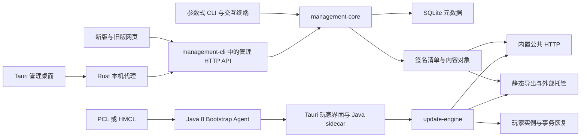

# 梦鱼更新系统代码审查与演进建议

审查日期：2026 年 10 月 14 日。代码基线：`6920cc4`，玩家端与管理端业务版本均为 `0.2.0`。审查开始时工作区干净；本次只新增报告与隔离复现材料，没有修改业务实现。

**主要结论：现有发布和更新核心值得继续使用，下一阶段应优先补齐正确性、资源边界和前端行为契约。当前证据不支持为了性能立即把整个管理端重写为 Rust。**

完整目标清单、项目独立签名、内容寻址、事务安装、回滚发布及启动门禁，已经组成了有价值的基础。新增桌面工作区则暴露了项目切换串数据、导入动作不匹配、失败重试退化等问题。它们表明“复用了后端”还不足以保证新旧界面具有相同的行为。

服主关心的资源问题也有明确答案：管理端空闲时比较轻，发布期间会明显增加 CPU、磁盘读取和内存占用；玩家集中下载主要消耗出口带宽，并可能耗尽目前的下载工作线程。长期运行还需要管理历史对象、导入暂存和恢复归档的磁盘增长。

| 关注点 | 判断 | 下一步 |
| --- | --- | --- |
| 架构合理性 | 核心分层方向合理，HTTP、命令行与部分应用编排混在一起 | 保留核心，拆分管理适配层和任务执行层 |
| 可拓展性 | 适合继续做单服及少量项目管理，尚不具备完善的多任务和多管理员模型 | 明确任务、权限、接口版本与生命周期 |
| 管理资源占用 | 空闲占用可接受；全量扫描、并发下载、历史存储需要约束 | 优先分发卸载、任务限流、存储计量 |
| 专属客户端方向 | 已有品牌、内容、可选组件和可信更新基础 | 先做服务器入口、实例健康和支持工具，再评估完整启动器 |
| 文档一致性 | 主流程大体一致，旧 ADR、部分操作说明和备份边界存在偏差 | 建立当前行为矩阵，明确历史文档状态 |
| 可复用性 | Java 应用服务复用较好，前端行为和跨语言 DTO 复用不足 | 提取共享工作流与类型契约，而不只是共享页面 |

**一、优先修复的问题**

P1 表示应在扩大使用范围前解决的明显误操作或可用性风险；P2 表示特定条件下错误、可靠性缺口或持续累积的运行问题。“动态复现”使用真实项目代码和人工生成的数据；前端复现使用真实 store 加模拟响应时序，不代表完成了全部 WebView 点击验收。

| 编号 | 优先级 | 问题 | 证据 |
| --- | --- | --- | --- |
| R1 | P1 | 快速切换项目后，当前项目 ID、项目详情与文件列表可能不一致 | 动态复现 |
| R2 | P1 | 慢下载可占满公共服务线程，健康检查和新下载一起排队 | 动态复现 |
| R3 | P2 | 新工作区把“跳过”提交为后端不支持的导入动作 | 前端与 Java 服务分别复现 |
| R4 | P2 | 导入重试重新上传，丢失已有暂存与提交状态；服务器导入错误项无法按相同入口重试 | 前端动态复现及控制流确认 |
| R5 | P2 | 文件哈希缓存被用于完整性判定，同大小同修改时间的内容变化可被漏检 | 动态复现 |
| R6 | P2 | 更新引擎的离线修复分支未检查游戏运行锁 | 动态复现，正常玩家入口有前置保护 |
| R7 | P2 | 桌面代理没有响应超时，也不能主动中止正在阻塞的转发 | 静态确认 |
| R8 | P2 | 玩家发行包暂存和被遗弃的上传缺少完整的回收生命周期 | 静态确认，源文件导入保留副本已实测 |
| R9 | P2 | 管理端源文件导入只有异常回退，缺少进程崩溃后的持久化恢复 | 静态确认 |

**R1：项目切换存在真实的异步竞争。**

[store.ts:44](D:/Desktop/DreamingFish-Updater/admin-desktop/src/workbench/store.ts:44) 中的 `loadProject()` 先按当前全局 `projectId` 请求详情，等待返回后再按届时的全局 ID 请求文件。`switchProject()` 没有设置加载锁，也没有请求代次校验。A 的详情慢、B 的详情快时，A 的旧响应可以在 B 加载完成后覆盖详情。

复现结果为 `selected=b displayed=a file=config/from-b`。这不只是显示错误：保存设置、维护规则等请求通过 `apiPath()` 指向 B，界面却可能显示 A 的名称和配置，从而诱导服主修改错误项目。探针没有实际删除或修改另一个项目。

应让每次加载捕获固定的项目 ID 和递增请求编号；详情、文件及派生状态验证为同一项目后再一次性提交。切换时取消旧请求并清空依赖项目的弹窗、选择和草稿。写操作也应绑定弹窗打开时的项目身份与配置版本，不能临时读取全局 ID。验收必须覆盖乱序响应、连续切换、切换失败和打开设置弹窗后切换项目。

**R2：公共下载服务只限制了线程数，没有形成完整的负载上限。**

[PublicFileServer.java:60](D:/Desktop/DreamingFish-Updater/management-core/src/main/java/cn/dreamingfish/updater/management/PublicFileServer.java:60) 使用 64 个固定平台线程，健康检查、清单与大文件共用该池。`newFixedThreadPool` 的队列无界，监听 backlog 128 也不是应用请求队列上限。[JDK 线程池文档](https://docs.oracle.com/en/java/javase/21/docs/api/java.base/java/util/concurrent/Executors.html#newFixedThreadPool(int,java.util.concurrent.ThreadFactory))明确说明了这一点。

在隔离的回环服务中，64 个请求读取同一个 32 MiB 人工对象、随后不读取响应，得到：工作线程活跃数 64；`/healthz` 在 2 秒内超时；关闭这些连接后立即恢复 200。队列剩余容量读数为 `2147483647`。这个复现证明线程饱和及健康检查被阻塞，没有把它夸大为已经测出内存耗尽。

仓库启动参数中也未发现最大连接数、请求时间或响应时间的限制。JDK 21 的相关默认值允许无限连接、无限请求与响应时间；空闲连接超时不能替代正在发送大文件的超时。[JDK HTTP 服务配置](https://docs.oracle.com/en/java/javase/21/docs/api/jdk.httpserver/module-summary.html)

应增加连接数与有界等待队列、清晰的过载响应、传输停滞处理和监控；给控制与健康检查保留执行能力。大规模分发优先使用现有静态导出接独立文件服务或对象存储。调整超时需考虑大文件与慢网络，不能简单规定所有下载必须在很短的总时间内结束。

**R3：“跳过”在新界面中必然报错。**

[Tasks.vue:20](D:/Desktop/DreamingFish-Updater/admin-desktop/src/workbench/Tasks.vue:20) 提供 `SKIP`，相同内容的文件还会被自动选择为跳过；[store.ts:69](D:/Desktop/DreamingFish-Updater/admin-desktop/src/workbench/store.ts:69) 却直接把它提交到 `/files/commit`。后端 [SourceTransferService.java:95](D:/Desktop/DreamingFish-Updater/management-core/src/main/java/cn/dreamingfish/updater/management/SourceTransferService.java:95) 只接受 `ADD`、`OVERWRITE`、`REPLACE_MOD`。

复现结果为 `SKIP_UI state=error sentAction=SKIP`，Java 服务也拒绝该动作。旧版 [file-transfer.js:176](D:/Desktop/DreamingFish-Updater/management-cli/src/main/resources/cn/dreamingfish/updater/management/cli/web/file-transfer.js:176) 已经正确地在客户端处理跳过并释放未提交暂存。

应恢复该工作流，增加明确的 skipped 状态，把跳过项排除在待导入数量与发布检查 ID 之外；相同文件的默认跳过也要进入回归测试。

**R4：重试没有利用后端已经具备的幂等能力。**

[store.ts:67](D:/Desktop/DreamingFish-Updater/admin-desktop/src/workbench/store.ts:67) 对 error 项重新调用上传，覆盖原有 `plan`，没有调用 `/files/recheck`，也没有处理 `plan.committed`。模拟“服务端已完成、响应丢失”的任务后，重试发生一次新上传，暂存 ID 从原提交 ID 变为 `new-stage`。实际后果可能是重复暂存、重复覆盖或因新旧检查不一致而继续报错。

服务器导入任务没有 `task.file`，会被同一函数直接跳过，界面仍把它标为需要重试。批量导入的最终检查失败时，项目列表刷新也被跳过，容易让服主误判已完成的工作。

旧版 [file-transfer.js:140](D:/Desktop/DreamingFish-Updater/management-cli/src/main/resources/cn/dreamingfish/updater/management/cli/web/file-transfer.js:140) 已经支持复查已有暂存和识别完成状态。应把这部分迁移成共享的导入状态机：保存项目身份和暂存 ID，先复查，再决定重试上传或提交；保留“文件已导入，但发布检查未通过”的独立结果。暂停当前上传与停止后续任务也应分别命名。

**R5：“已验证”有一部分实际上依赖可失效的文件元数据缓存。**

[LocalFileIndex.java:84](D:/Desktop/DreamingFish-Updater/update-engine/src/main/java/cn/dreamingfish/updater/engine/LocalFileIndex.java:84) 只用文件大小和毫秒级 mtime 判断是否复用 SHA-256；`matches()` 也调用该缓存。离线验证和事务目标验证存在相应调用路径。

探针先验证一个强制文件，再把 `good` 改为等长的 `evil` 并恢复原 mtime。离线检查返回 `OFFLINE_ALLOWED`，文件内容仍为 `evil`。保留时间戳的同步、还原工具也可能产生这一条件，不必修改哈希算法或签名。

这是本地完整性语义问题，不是远程签名被破解，也不能据此把更新器当成反作弊工具。缓存可用于快速展示与候选筛选；严格校验、离线可信许可和明确的“修复/完整检查”应能强制重新哈希。需明确哪些启动检查是快速检查、哪些承诺完整验证，并测试相同大小与时间戳、替换文件、缓存损坏及缓存篡改。仅增加 fileKey 也不能证明内容没有变化。

**R6：离线修复可以在没有独占游戏锁时修改实例。**

[UpdateEngine.java:72](D:/Desktop/DreamingFish-Updater/update-engine/src/main/java/cn/dreamingfish/updater/engine/UpdateEngine.java:72) 遇到网络不可用直接进入离线分支；[209 行](D:/Desktop/DreamingFish-Updater/update-engine/src/main/java/cn/dreamingfish/updater/engine/UpdateEngine.java:209) 的安装调用没有检查先前得到的 `gameUpdateLock` 是否为空。

探针持有与 Agent 等价的共享游戏锁，使用声明当前简化维护能力的可信基线，触发已知坏文件的离线移除。结果为 `OFFLINE_ALLOWED badFileExists=false archived=1`：锁仍被占用，文件已经移走。

目前 [PlayerController.java:502](D:/Desktop/DreamingFish-Updater/player-app/src/main/java/cn/dreamingfish/updater/player/PlayerController.java:502) 会先获取游戏锁，正常重复启动通常会提前拒绝，因此应把它评为引擎接口的边界缺陷，而不是宣称所有正常启动都在热修改游戏。未来做常驻专属客户端时，这个缺口更容易暴露。应要求恢复、安装、离线修复共享同一个持锁上下文；无锁时仅允许明确无写入的检查。

**R7：桌面连接遇到“连接还在，但服务不再响应”时可能长期卡住。**

[workbench.rs:56](D:/Desktop/DreamingFish-Updater/admin-desktop/src-tauri/src/workbench.rs:56) 设置了连接超时，却显式 `.timeout(None)`。8 个转发工作线程同步等待 `send()` 或响应体。`Drop` 只设置停止标记和唤醒接收，不中断已经进入阻塞转发的请求；前端 fetch/XHR 也未配置对应取消与超时。

因此，网络黑洞或远端异常时，工作线程和客户端资源可能继续存活；正常连接下的端口释放测试不能覆盖这一状态。此项为静态控制流确认，未将其描述成已经测得持续泄漏的字节数。

应区分短 API 与大文件传输，设置响应头及停滞期限，跟踪活动请求并在断开时取消，保存并等待工作线程退出。补充远端接收请求后不回复、响应半途停止、上传中断开以及反复连接的测试。

**R8：暂存、导入历史和发布对象的保留策略需要分开。**

[PlayerPackageService.java:48](D:/Desktop/DreamingFish-Updater/management-core/src/main/java/cn/dreamingfish/updater/management/PlayerPackageService.java:48) 发布玩家程序后没有清理 ZIP 与解压目录；[DeliveryView.vue:24](D:/Desktop/DreamingFish-Updater/admin-desktop/src/workbench/DeliveryView.vue:24) 清空前端 plan，却没有调用释放接口。反复检查发行包、换文件或关闭窗口，还会留下无法从当前界面再次找到的暂存。

源文件导入成功后保留 payload、stage 和 receipt，本次也已确认。保留导入前副本和一部分 payload 有恢复用途，不能简单当垃圾删掉。但对象存储去重并没有覆盖这些额外副本。每文件 4 GiB 的限制也不是总暂存配额，历史列表只显示 40/200 条并不表示磁盘只保留这些条目。

应为未提交暂存设置过期、配额和清理入口；程序包成功发布后释放可重建的暂存；已提交导入按恢复承诺保留必要引用。进一步可把恢复副本放入内容寻址存储，维护引用关系。发布历史对象的保守保留已在设计中声明，应继续保护，清理前显示会失去哪些回滚或恢复能力。

**R9：管理端文件导入的“可恢复”还没有覆盖断电与进程强制退出。**

[SourceTransferService.java:137](D:/Desktop/DreamingFish-Updater/management-core/src/main/java/cn/dreamingfish/updater/management/SourceTransferService.java:137) 在内存中构造 receipt，随后替换目标、删除旧路径、更新规则，最后才写 `receipt.json`。catch 中能够回退普通异常，但进程在上述动作之间退出时不会执行 catch，也没有对应的启动恢复扫描。

这可能让标准源目录保留部分导入结果，而恢复清单缺失或规则尚未完成；发布时的最终扫描仍提供另一道保护，因此不等于已经证明坏版本必然发给玩家。已有归档也不意味着源数据一定永久丢失，问题在于无法自动判断并恢复操作状态。

应在第一处文件修改前持久化操作意图、原状态与恢复位置，记录提交阶段，启动时处理未完成操作。可以复用玩家事务的设计原则，保留管理端独立的领域状态。验收需要真实子进程故障注入，分别在复制后、移除后、规则写入后和 receipt 提交前退出。

**二、架构合理性与可拓展性**

当前主要调用关系如下。图中两种公共分发方式是可选部署方式；管理桌面代理与公共下载服务承担不同职责。

值得保留的设计有五项：

1. **完整目标状态。** 玩家不必按补丁链逐个升级；持续移除和问题文件要求进入目标状态，比依赖客户端曾经过哪些版本更可靠。
2. **项目独立签名与内容寻址。** 下载来源和发布身份可以分离，相同对象可复用，外部托管不必获得项目私钥。
3. **回滚生成新发布。** 内容回退与序号防重放可以共存；这条规则应继续成为不可破坏的约束。
4. **业务服务被多个入口共用。** CLI、Web 与桌面基本使用同一组 Java 服务，未来增加自动化入口有基础。
5. **启动门禁和 UI 解耦。** Agent 目标 Java 8，核心 Java 21，界面通过 sidecar 工作；Bootstrap 单独验证程序，游戏许可不依赖窗口是否关闭。

这些设计也有实际测试支撑：路径安全、签名、版本重放、事务失败恢复、源目录一致性、旧协议与文件维护行为并非只写在 README 中。本轮重跑的既有测试通过，不能据此消除 R1–R9，但足以说明保留核心再改进具有价值。

目前的主要结构压力集中在边界：

| 边界 | 具体表现 | 建议 |
| --- | --- | --- |
| 管理适配层 | `AdminWebServer.java` 2,505 行，包含路由、认证、DTO、源文件浏览、打包下载和任务编排 | 拆为 HTTP 适配、认证、项目查询、上传与任务入口；发布编排回到应用服务 |
| 应用生命周期 | `ManagementCli.services()` 每次构造服务并执行数据库初始化；HTTP 代码有大量重复调用 | 每个后端生命周期建立服务容器，数据库初始化与迁移只在明确启动阶段执行 |
| 写操作并发 | 一个全局 `mutationLock`；长时间上传、导出会使其他项目写入也收到 409 | 保留每项目一致性锁；长期操作进入可查询任务，另设全局资源并发限制 |
| 玩家编排 | `PlayerController.java` 830 行，混合程序更新、展示、偏好、游戏许可与恢复 | 分出启动检查应用服务、实例维护服务和展示控制器 |
| 协议职责 | `protocol` 同时有签名目标、品牌内容和 Minecraft 模组元数据读取；引擎直接识别模组 | 随实际需求拆开更新协议、内容展示、Minecraft 适配，避免核心继续吸收社区功能 |
| 版本契约 | Java、TypeScript、Rust 多处维护 DTO，管理前端广泛使用 `Record<string, any>` | 形成版本化 API/IPC schema，生成或校验类型；把接口能力与 UI 版本分开 |

以上行数是当前 Git 跟踪文件的物理行数，含空行与 Rust 文件中的内联测试；用于提示阅读负担，不作为质量评分。六个 Java 模块及两个前端目录中，排除独立测试目录的 Java/Rust/TS/Vue/JS 文件共 287 个、42,381 行。新管理 store 大量逻辑压在单行中，行数较少也不代表职责较少。

SQLite 对当前少量服主、少量写入的模型是合理选择。[ManagementDatabase.java:579](D:/Desktop/DreamingFish-Updater/management-core/src/main/java/cn/dreamingfish/updater/management/ManagementDatabase.java:579) 已启用 WAL、外键、busy timeout 和 FULL 同步。不建议仅因未来想扩展就换成外部数据库或微服务。先明确多项目并发、任务恢复、数据迁移版本和管理员角色；只有出现经测量的写入并发或跨机器部署需求，再调整存储。

公共服务与管理服务目前主要是监听器和路由隔离，仍可能处在同一 JVM，公共 presentation 请求还会实时加载私钥并签名：[PublicFileServer.java:265](D:/Desktop/DreamingFish-Updater/management-core/src/main/java/cn/dreamingfish/updater/management/PublicFileServer.java:265)。若要让公网分发节点不接触私钥，可在管理变更时生成签名展示文档，公共节点只读取产物。现有静态导出已经提供了实现这一步的基础。

关于 Rust 重写：先解决全量 I/O、任务生命周期、复制份数和下载资源上限，再在同等输入下比较 CPU、内存、包体与维护成本。语言替换不会自动修复跨项目竞争、无界队列或重复上传。若以后仍需要重写，应先固定签名字节、路径约束、能力协商、历史清单和恢复语义的兼容测试，按模块替换，避免同时重写协议与实现。

**三、管理端性能与服务器资源**

**实测条件。** Windows 本机，32 个逻辑处理器、31.8 GiB 内存，Oracle JDK 21.0.9，使用本次构建的真实管理 JAR。独立启动 `desktop` 后端和回环公共下载服务，没有启动 Tauri/WebView。数据为 1,024 个 128 字节配置文件和 64 个 4 MiB 普通资源文件，共约 256.125 MiB。未设置 `-Xmx`，文件刚生成，操作系统缓存较热；每项只测一轮，不能外推为低配 Linux 或真实 JAR 整合包的容量承诺。

内存是 Java 进程工作集 RSS，每 20 ms 采样；I/O 是进程读取计数，包含缓存命中，并非磁盘物理读盘量。CPU 秒是所有线程消耗之和，不等同于墙钟时间或整机占用百分比。

| 操作 | 耗时 | CPU 秒 | 采样峰值 RSS | 读取量 | 写入量 |
| --- | ---: | ---: | ---: | ---: | ---: |
| 空项目空闲观察 | 5.00 s | 0.00 | 128.9 MiB | 0 | 0 |
| 列出 1,088 个文件 | 0.20 s | 0.58 | 140.3 MiB | 0.2 MiB | 约 0 |
| 首次扫描 | 2.20 s | 2.91 | 269.8 MiB | 256.2 MiB | 0.5 MiB |
| 首次发布 | 14.84 s | 14.67 | 421.3 MiB | 514.5 MiB | 257.5 MiB |
| 内容不变再次扫描 | 2.02 s | 2.39 | 433.0 MiB | 256.7 MiB | 0.3 MiB |
| 内容不变再次发布 | 5.08 s | 4.58 | 180.1 MiB | 514.6 MiB | 1.4 MiB |
| 操作后空闲观察 | 5.00 s | 0.00 | 170.1 MiB | 0 | 0 |

空项目观察结束为 118.3 MiB，全部操作后的观察结束为 161.0 MiB。中途约 433 MiB 的峰值及后续回落可能包含 JVM 扩堆、分配和垃圾回收影响，不能把差值直接判为内存泄漏。原始结果保存在[资源测量数据](D:/Desktop/DreamingFish-Updater/docs/reviews/repro-2026-10-14/resource-results.json)。

**发布的主要成本按整个包增长。** [ScanService.java:469](D:/Desktop/DreamingFish-Updater/management-core/src/main/java/cn/dreamingfish/updater/management/ScanService.java:469) 每次扫描重新哈希文件。发布时 [PublishService.java:75](D:/Desktop/DreamingFish-Updater/management-core/src/main/java/cn/dreamingfish/updater/management/PublishService.java:75) 逐对象导入或验证，然后再次完整扫描。对总大小 S 的包，一次“检查并发布”大致涉及约 3S 的内容读取；已有对象减少写入，却没有免除读取。这与实测吻合。

最终校验保护了发布一致性，不能为了快直接删掉。可把源目录元数据和模组信息索引用于快速预览、按批次复用目录快照，再让发布边界对确定的不可变输入进行必要的严格验证。快照的建立成本、源文件外部修改和 Windows 文件占用必须一起设计。

**文件列表不等于全量哈希，但仍重复遍历。** `SourceFileService.list()` 会走整个源目录、读取文件属性，尽量复用扫描结果中的 JAR 元数据；没有可复用记录时重新读 JAR。`sourceFilesView()` 又单独获取目录列表。每个导入项的 `plan()` 都调用全项目列表，提交时再检查，批量导入 M 个文件到 N 个文件的项目会带来约 M×N 级别的重复列表工作。应使用有版本的项目索引，批量检查共享快照，对提交的受影响文件再验证，而不是把每个小文件都当全项目操作。

**下载主要吃带宽、连接和磁盘缓存。** 对象使用 128 KiB 缓冲流式传输；64 个活跃传输的这部分缓冲约 8 MiB，此外还有线程栈、连接、HTTP 状态、清单与 JVM 本身。默认每玩家 4 路下载，最高可调到 8 路；16 个同时满速使用 4 路的玩家就可能占满 64 个处理槽。这是饱和示例，不是“最多只能支持 16 名玩家”的容量结论。

例如 100 名玩家各需下载 200 MiB，总出口约 19.5 GiB。在可完全利用的 100 Mbps 出口上，理论传输下限也约 28 分钟，尚未计入协议与其他业务。换语言无法减少这部分字节；对象存储/CDN 或独立分发机才直接改变游戏服务器承担的出口压力。

**长期更容易被忽视的是磁盘。** 应分别统计：标准源 S、所有历史版本的唯一对象 U、可恢复归档 A、未完成暂存 T、静态导出 E，以及备份临时文件。总体接近 `S + U + A + T + E`，不会始终只有一份整合包。加密备份先写 ZIP 再生成密文，期间还需要同时容纳这些临时产物。静态导出默认包含全部历史发布和程序版本，维护成本也会随历史增长。

**桌面与服务器占用应分开看。** 远程使用桌面管理时，WebView、Vue 和 Rust 代理主要运行在服主电脑；服务器运行 Java 管理与分发服务。本机模式会同时拥有桌面、WebView 和 Java 子进程。上述 RSS 不能代表完整桌面程序，也未测 Linux 常驻 RSS。关闭桌面窗口会进托盘并保留工作，与完全退出不同，文档对此基本准确。

部署和优化顺序建议：

1. 少量服主先沿用现有 Java/SQLite；为管理进程单独安排内存余量，在实际包和峰值并发下确定预算，不从本次 118 MiB 空闲值推导最低内存要求。
2. 与 Minecraft 共机时，扫描、导出、备份避开玩家高峰；监控磁盘延迟、CPU、RSS、下载队列和游戏延迟。
3. 玩家规模增长时，把签名产物导出到独立分发服务；管理端只在修改与发布时工作，私钥留在管理环境。
4. 增加任务进度、并发限制、取消、剩余磁盘预检查与失败后的清理。先让资源有边界，再讨论更激进的并行。
5. 管理前端对大目录使用分页或虚拟列表，并预计算目录聚合。目前普通循环渲染和多次 `filter` 在大包中会增加浏览器负担。[Vue 大列表性能建议](https://vuejs.org/guide/best-practices/performance.html#virtualize-large-lists)

本次构建的新网页 JS gzip 约 77.7 kB，CSS gzip 约 16.9 kB，但两个中文字体原文件合计约 8.6 MB。首次加载应优先处理字体子集、按需字体或系统字体回退，并对带内容哈希的静态资源配置长期缓存。这项影响管理页面首次打开，不能把它归为服务端 Java 常驻内存问题。

**四、发展为服务器专属客户端**

建议把产品目标定义为：**让玩家从一个可信入口了解服务器、准备可用实例、解决连接问题并进入游戏。** 现有更新器可以成为其中的维护核心。品牌页面、音乐和封面已经存在，下一步最有价值的是把它们与真实服务状态和玩家问题连接起来。

| 阶段 | 具体能力 | 玩家收益 | 验收标准 |
| --- | --- | --- | --- |
| 第一阶段：服务器入口 | 状态、维护公告、更新摘要、规则、活动、支持入口；独立打开的入口模式 | 不用启动游戏才知道服务器维护或需要处理什么 | 服务离线仍能显示已缓存内容；公告失败不阻止可靠更新 |
| 第二阶段：实例健康 | 一键检查/修复、可选性能配置、恢复入口、错误解释、诊断包预览 | 从“启动失败”走到可执行的解决办法 | 修复保留玩家数据；诊断先预览脱敏结果，再由玩家决定导出或发送 |
| 第三阶段：游戏协作 | 按支持矩阵提供可选模组/插件桥接，反馈入服要求、维护状态和兼容问题 | 更新目标和服务器实际入服条件一致 | 不支持桥接的平台仍能基础更新；服务端独立验证入服条件 |
| 后续评估：启动整合 | 经过验证的启动器适配、实例选择和启动状态 | 减少入口切换 | 逐启动器、游戏版本、Loader 验收；不假定通用启动命令一定可用 |

第一阶段不宜一次塞入聊天、商店、好友、账号系统、地图和通用插件平台。可以先选择“服务器状态 + 实例体检 + 可解释的修复”这条主线，用真实服主与玩家使用数据判断后续投入。推荐关注首次准备成功率、每次更新失败率、修复成功率、重复下载字节和从打开客户端到成功入服的时间，而不是只统计新增页面数。

技术上需要提前确定四条边界：

- **实例生命周期。** 区分未启动、检查中、下载中、提交中、允许启动、运行中和恢复待处理。游戏运行期间可以刷新公告或预下载对象，文件提交必须等待游戏退出并获得独占锁。R6 应在常驻模式之前修复。
- **产品内容与文件维护分开版本化。** 新闻和维护提示不应要求一次整合包发布，整合包发布也不应依赖新闻接口正常。已有 `PlayerPresentation` 是起点，但应逐步从膨胀的 Branding/ReleaseManifest 中分出明确的内容协议。
- **服务器身份与信任。** 保留签名发布和项目绑定，补充签名密钥轮换、丢失/泄漏后的恢复路径及客户端兼容策略；这些属于扩大分发规模前应明确的运维能力。
- **受控扩展。** 用明确的数据结构、受限主题、声明式页面和功能能力扩展。玩家端目前 [tauri.conf.json:32](D:/Desktop/DreamingFish-Updater/player-ui/src-tauri/tauri.conf.json:32) 的 CSP 为空；虽然 Markdown 渲染器禁用了原始 HTML，这也不适合直接扩展为可执行任意第三方脚本的页面系统。先设计内容权限和原生能力隔离。

完整启动器会额外带来账号授权、令牌保管、游戏资源与 Java 安装、Loader 安装、平台适配和长期启动兼容工作。当前 [ADR 0003](D:/Desktop/DreamingFish-Updater/docs/adr/0003-keep-the-player-app-focused-on-updates.md) 明确把这些职责交给第三方启动器。若将来决定接管，应该用新的 ADR 明确替代该范围，并作为独立产品阶段验收。

客户端报告只能用于兼容提示和社区规则协作。现有 [ADR 0006](D:/Desktop/DreamingFish-Updater/docs/adr/0006-enforce-mod-blacklists-at-server-admission.md) 已正确声明它不能成为可靠反作弊边界；未来加入入服检查时应保留这一点。

**五、文档与实现对照**

历史审查记录中的旧问题已经有修复说明，不能照搬为当前缺陷。本次主要对照 README、CONTEXT、V1-DESIGN、部署与快速开始、新旧工作区文档、相关 ADR 以及当前代码；官网站点本次未能成功读取，其在线内容没有纳入一致性结论。

| 文档或声明 | 当前代码 | 判断与修订建议 |
| --- | --- | --- |
| [README 的完整目标、签名、断点续传与事务更新](D:/Desktop/DreamingFish-Updater/README.md) | 对应实现及测试存在 | 基本一致；“完整性检查”的范围需结合 R5 解释缓存策略 |
| [ADR 0013:7](D:/Desktop/DreamingFish-Updater/docs/adr/0013-use-only-the-built-in-http-artifact-source-in-v1.md:7) 仍以 accepted 排除 CDN、对象存储、WebDAV、HTTPS 终止 | 已有静态导出、WebDAV/S3 上传及 HTTPS 管理方案 | 明确被哪个后续决策替代，保留原文历史，不让它继续作为当前禁止项 |
| [ADMIN-WORKSPACE:57](D:/Desktop/DreamingFish-Updater/docs/ADMIN-WORKSPACE.md:57) 说明断线后重新检查可识别已导入项 | 旧版具备，新 Vue 工作区未使用复查与 committed 状态 | 修复 R4；迁移期间明确该行为适用于哪个界面 |
| [ADMIN-WORKSPACE:63](D:/Desktop/DreamingFish-Updater/docs/ADMIN-WORKSPACE.md:63) 说明发布拒绝后自动重新检查 | 新 `publish()` 直接抛错，没有重扫分支 | 修复行为或将文档明确限制为旧版；不能把后端拒绝说成界面自动恢复 |
| [DEPLOYMENT:746](D:/Desktop/DreamingFish-Updater/docs/DEPLOYMENT.md:746) 仍描述“删除，但保留自行管理玩家副本”的服主选项 | 新维护界面只有 DELETE 和 RELEASE，旧枚举主要用于兼容 | 改为当前两种选择；旧语义移到迁移/历史兼容说明 |
| [CONTEXT:203](D:/Desktop/DreamingFish-Updater/CONTEXT.md:203) 泛称备份包含项目管理数据 | `BackupService.writeZip()` 只含数据库、密钥、清单、玩家程序和对象树 | 补充源文件操作/导入恢复记录与归档不在加密包内，不让用户以为撤销历史也完整恢复 |
| [部署备份范围](D:/Desktop/DreamingFish-Updater/docs/DEPLOYMENT.md:781) 已排除运行设置、Web 账户与标准源目录 | 与代码一致 | 保留这个准确区分；增加 source-imports、source-archive、source-operations 的迁移说明 |
| 两份旧审查文档的页首仍写“0.3.0 已采用简化维护方案” | 当前业务版本为 0.2.0，另有版本编号修正记录 | 页首改为当前编号或明确“当时临时编号”，正文历史证据可保留 |
| [V1-DESIGN 的平台无关核心](D:/Desktop/DreamingFish-Updater/docs/adr/0007-separate-the-universal-core-from-platform-support.md) | 核心直接依赖 Minecraft 模组身份与目录语义 | 改为“公共文件更新机制可复用、现有策略含 Minecraft 适配”，或逐步落实适配接口 |
| [管理桌面使用说明](D:/Desktop/DreamingFish-Updater/docs/ADMIN-DESKTOP.md) 的本机/远程、托盘与独立数据目录 | Rust 生命周期与 Java desktop 入口相符 | 基本一致；异常连接释放仍需覆盖 R7 |

文档维护建议只有一个“当前行为入口”：以版本化的能力矩阵列出 CLI、新网页、旧网页和桌面的支持情况，每项链接到 API 和对应验收。ADR 记录决策变化，CHANGELOG 记录版本变化，历史审查只保留当时证据。文档中的“自动”“全部”“可恢复”“无残留”等词应由具体的故障场景测试支持。

**六、代码复用与开发流程**

| 资产 | 复用程度 | 后续处理 |
| --- | --- | --- |
| 签名与清单格式、路径校验 | 较高 | 固定协议样本；保持旧清单解释稳定 |
| 发布、对象存储、部署与恢复应用服务 | 较高 | 保留 Java 公共服务；统一注入和任务上下文 |
| 更新引擎 | 有价值，但有本地锁/缓存约束及 Minecraft 语义 | 明确无 UI 的公开用例、完整验证模式和 Loader 适配边界 |
| 新网页与桌面工作区 | 已复用同一 Vue 源码 | 保留双构建入口，给真实工作流增加共享测试 |
| 新旧前端之间 | API 共用，工作流重复 | 优先共享导入、发布、错误恢复状态机，迁移完成后制定旧版退场条件 |
| DTO 与 IPC | 手写类型较多，管理界面大量 any | 使用 schema 约束请求、响应、错误码和能力；再考虑生成客户端 |
| 原子文件操作与恢复 | 多个模块有相近代码 | 先对齐不变量，再提取小而明确的文件原语；保留 Java 8 Bootstrap 的独立兼容边界 |

不要为了“复用”把所有服务塞进通用工具包，也不要让公告、账号、游戏状态成为更新引擎的依赖。更合理的结构是：协议与文件维护核心、应用用例、HTTP/CLI/桌面适配、Minecraft 平台适配。只有出现第二个真实使用者时，再抽象可替换实现。

新前端最值得提取的是 `ProjectSession`、导入任务、发布预览与确认、认证会话和内容编辑状态。`Data = Record<string, any>` 让“前端发了 SKIP 而后端拒绝”可以通过类型检查；共享枚举只能防止拼写差异，完整的状态转换和恢复协议还需要契约测试。

当前管理前端 15 项测试主要覆盖模型和展示函数，没有覆盖关键 store 工作流；R1、R3、R4 正好落在这个空隙。旧网页 4,348 行 `app.js`、新 store 的长单行函数、Java 2,505 行 HTTP 类也增加了审查成本。可以先规范格式和划分职责，再做行为变更，避免把大型格式化与功能修改混在一个提交中。

仓库未发现已提交的 `.github/workflows`；本机脚本虽然有测试和发行包核对，无法证明每次提交都经过同样检查。建议建立 Java 21、两套前端和两端 Rust 的 CI，加入生成发行包资源存在性检查、协议兼容样本、文档命令冒烟测试。Maven 依赖预先生成的前端 dist，单独 Maven 成功不保证全新环境已经构建了最新版网页；正式构建应使用统一入口并检查嵌入产物版本。

对 AI agent 的实施要求应具体到任务交付：每个跨层功能同时提交接口约定、失败状态、恢复路径、文档改动和至少一个关键工作流测试。涉及文件移动的任务必须写清“哪一步之前可以取消、崩溃后读什么恢复、何时允许删除旧副本”。这种约束比继续叠加大段泛化开发规范更容易验收。

**七、依赖风险核对**

使用官方 npm registry 对当前锁文件执行 audit：管理前端报告 2 个 high 包条目，玩家前端报告 4 个 high、2 个 moderate 包条目。依赖传播会让同一公告同时出现在上游包和直接依赖中，所以不能把它们说成 8 个独立漏洞。

| 锁定依赖 | 公告与修复下限 | 项目中的判断 |
| --- | --- | --- |
| 两端 Vue / server-renderer 3.5.40 | SSR 属性名 XSS，修复版本 3.5.42；[公告](https://github.com/advisories/GHSA-g2v6-rqmx-r4w6) | 当前是静态 SPA，未发现服务端 Vue 渲染调用；应升级，但未证实该漏洞在发行应用可达 |
| 玩家 Vitest / mocker 4.1.10 | mock 重定向路径遍历，修复版本 4.1.11；[公告](https://github.com/advisories/GHSA-82fw-gwwq-j7x9) | 属于测试开发依赖，优先保护开发测试环境，不应直接宣称玩家端能任意读文件 |
| 玩家 nanoid 3.3.16 | 自定义生成器特定输入可能无限循环，3.x 修复下限 3.3.18；[公告](https://github.com/advisories/GHSA-2v37-7h3g-55p8) | 源码未发现直接使用该触发 API，仍应更新传递依赖 |
| 玩家 source-map-js 1.2.1 | 特定索引 source map 可导致事件循环拒绝服务，修复版本 1.2.2；[公告](https://github.com/advisories/GHSA-68fv-2mgg-jv7q) | 未复现发行包入口的可达攻击，按工具链与传递依赖处理 |

本次没有执行 `audit fix`、升级锁文件或改变依赖。升级时保留补丁级更新的审查，重跑构建与真实入口测试。Java 与 Rust 依赖未做完整公告数据库扫描，因此这部分不构成全语言依赖安全认证。

**八、建议的整改顺序与验收**

| 顺序 | 工作 | 完成标准 |
| --- | --- | --- |
| 第一批：防误操作与明显回归 | R1、R3、R4；明确过期发布预览行为 | 乱序项目响应不串数据；相同文件跳过成功；响应丢失后能识别已完成导入 |
| 第二批：明确资源与文件安全边界 | R2、R5、R6、R7；依赖补丁更新 | 下载饱和时健康检查及新请求有界返回；严格模式发现同 mtime 内容变化；无游戏锁绝不提交；断开后活动转发退出 |
| 第三批：长期维护能力 | R8、R9；存储统计、暂存回收、持久任务、备份范围修订 | 可识别并恢复未完成导入；知道每类存储的占用与保留承诺；任务状态可恢复查询 |
| 第四批：降低变更成本 | HTTP 与 store 拆分、API/IPC schema、共享工作流、CI 与兼容样本 | 新旧入口对同一输入给出一致结果；新接口不靠运行时猜测字段 |
| 第五批：专属客户端最小版本 | 独立入口、服务器状态、实例健康与支持工具 | 玩家能明确知道能否进入服务器、失败原因和下一步处理方式 |

值得新增的回归用例包括：上传已提交但响应丢失、服务器导入后重试、相同文件跳过、A/B 项目乱序返回、64 个慢下载下控制接口可用、断线后重复连接、游戏运行期间离线维护、相同大小与时间戳的文件变化、管理进程在导入中途退出。这些测试验证实际故障与边界，不必为每个小函数机械补测试。

性能验收应再补真实项目与目标机器上的两组数据：其一是数千文件和数 GiB 整合包的扫描、少量变更发布、备份与恢复；其二是并发下载加慢连接时的 CPU、RSS、磁盘延迟、队列长度和响应分位数。把可接受预算写进配置与发布检查后，再决定是否需要替换 HTTP 实现或运行时。

**九、本次验证记录与使用边界**

| 检查 | 结果 |
| --- | --- |
| Maven `verify`，JDK 25.0.3 | 通过 |
| Maven `verify`，目标 JDK 21.0.9 | 通过；最终 Surefire XML 汇总 266 项，0 失败、0 错误、0 跳过 |
| 玩家前端 Vitest、类型检查与生产构建 | 74 项通过，构建通过 |
| 管理前端 Node tests、类型检查、网页与桌面前端构建 | 15 项通过，两种构建通过 |
| 管理桌面 Rust `cargo test --locked` | 14 项通过 |
| 玩家桌面 Rust `cargo test --locked` | 9 项通过 |
| 隔离缺陷探针 | 复现项目竞争、SKIP、重试重传、同 mtime 漏检、离线锁缺口及下载饱和 |
| 真实管理 JAR 资源测量 | 已完成，原始数据与复现脚本随报告保存 |
| npm 依赖公告检查 | 已完成，发现上列告警，未自动修改依赖 |

复现入口见[探针说明](D:/Desktop/DreamingFish-Updater/docs/reviews/repro-2026-10-14/README.md)。它们只创建仓库 target 下的人工数据和本机回环监听，不访问服主真实项目或玩家实例。

本次没有完成 Linux 性能实测、安装器安装/卸载、真实 Minecraft/Loader/启动器组合验收、长时间公网压测或全部页面的视觉与无障碍审查。报告对这些内容给出的是后续验收要求，不把已有单元测试、历史验收记录或本机模拟结果替代为生产保证。
