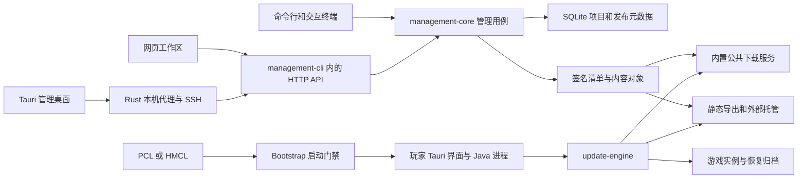

# DreamingFish Updater 完整代码复审与演进建议

审查日期：2026 年 10 月 18 日。代码基线：`b8793bbae74ffd57be176bfd153cac0e38bc472c` 及审查开始时的工作区；管理端和管理桌面版为 `0.2.5`，玩家端为 `0.2.1`，Bootstrap Agent 为 `0.1.2`。对照上次 `6920cc4` 基线，已提交变更涉及 69 个文件。原有未提交的权限生成文件、品牌素材和旧审查材料均予以保留；此次新增报告与隔离探针，没有修改业务代码。

**总体判断：发布和更新核心值得继续发展。当前最需要补齐的是文件操作失败后的恢复、界面与后端的行为一致性，以及资源使用的上限。现有证据不足以支持为了性能重写整套 Java 管理端。**

可以把这个项目理解为三部分：服主整理并签发内容的“工作台”、把内容送给玩家的“下载站”、玩家电脑上执行更新的“安装工”。三部分已有相当好的基础，但新增桌面能力让连接记录、目录搬迁、网络中断和界面状态之间的配合更复杂了。近期易用性修复有实际价值，不过没有覆盖上次报告中的大部分关键问题。

相较上次，项目创建增加了目录预检和更具体的错误说明，玩家更新地址可以稍后填写且发布入口仍会检查，桌面增加了签名自更新、数据迁移和 WebView 故障处理。这些变化都有对应实现；其中新迁移流程暴露出的失败状态，是本轮新增问题的重点。

| 你关心的问题 | 本次判断 |
| --- | --- |
| 架构是否合理 | 模块划分与技术组合合理；管理 HTTP 入口、桌面生命周期和前端状态管理开始过于集中，应局部拆分。 |
| 会不会大量占用服务器资源 | 空闲与发布、分发是不同负载。需要关注全量校验的磁盘读取、下载出口带宽和慢连接；桌面界面的 WebView 占用主要落在运行桌面的电脑上。 |
| 能否成为服务器专属客户端 | 能。适合先发展为服务器入口、实例维护和故障诊断中心，继续与现有启动器协作。 |
| 文档是否准确 | 主流程基本对应实现；便携版搬家、迁移失败回退、导入重试、旧 ADR 和备份范围存在偏差。 |
| 代码是否可复用 | Java 核心和网页／桌面共用界面已有较好复用；工作流、接口类型和失败处理的复用不足。 |

这里的 P1 表示应优先于继续扩功能解决；P2 表示在明确条件下出现的错误或长期可靠性问题。动态复现是对当前生产代码运行隔离探针；静态确认是沿代码调用关系确认，未等同于实机发生过事故。以下编号属于本次报告。

**一、应优先处理的问题**

| 编号 | 优先级 | 问题 | 与上次相比 | 证据 |
| --- | --- | --- | --- | --- |
| R1 | P1 | 桌面数据迁移失败后，实际数据位置与连接、提示不一致 | 新增发现 | 当前迁移代码动态复现，入口控制流确认 |
| R2 | P1 | 快速切换项目可能把 A 的详情显示在 B 的操作上下文中 | 上次 R1 仍存在 | 真实 store 加乱序响应复现 |
| R3 | P1 | 慢下载占满公共线程后，健康检查和新请求一起等待 | 上次 R2 仍存在 | 当前公共服务动态复现 |
| R4 | P2 | 旧连接配置读失败后，迁移仍删除原配置与有效备份 | 新增发现 | 当前迁移代码动态复现 |
| R5 | P2 | 便携版换位置后，已保存的本机连接仍指向旧目录 | 新增发现 | 当前配置与迁移代码动态复现，连接入口确认 |
| R6 | P2 | 导入清单的“跳过”被当作不支持的操作提交 | 上次 R3 仍存在 | 前端、后端分别复现 |
| R7 | P2 | 导入重试没有识别已提交结果，还会重新上传 | 上次 R4 仍存在 | 真实 store 复现及控制流确认 |
| R8 | P2 | 桌面代理对无响应的远端缺少请求期限与主动取消 | 上次 R7 仍存在 | 静态确认 |
| R9 | P2 | 同大小、同修改时间的文件变化可能通过“已验证”检查 | 上次 R5 仍存在 | 当前更新引擎动态复现 |
| R10 | P2 | 更新引擎离线修复分支缺少游戏锁检查 | 上次 R6 仍存在 | 当前更新引擎动态复现 |
| R11 | P2 | 暂存包和历史副本缺少总量与生命周期管理 | 上次 R8 仍存在 | 代码确认，源文件暂存保留已复现 |
| R12 | P2 | 管理端文件导入缺少进程崩溃后的事务恢复 | 上次 R9 仍存在 | 静态确认 |

**R1：搬完数据后保存失败，程序仍说“继续使用原位置”。**

容易理解的场景是：升级程序正在把旧 AppData 里的管理数据搬到程序旁边，搬运本身成功了，但保存新的连接记录时失败。失败可能来自磁盘写入、文件占用或目录状态异常。现在的实现先移动 `management`，再保存 `connections.json`；后一步失败时没有把前一步回退，也没有持久化记录供下次接着处理。[迁移顺序](D:/Desktop/DreamingFish-Updater/admin-desktop/src-tauri/src/migrate.rs:65)

探针用人工目录让连接配置保存失败，得到：旧管理目录已不存在、新目录中的人工密钥仍在、旧连接指向不存在的位置，而提示包含“继续使用原位置”。**这次复现没有丢掉项目密钥，问题是数据与找到它的记录脱节了。**

还有另一种情况：旧管理目录被占用，迁移在搬运前失败。探针确认旧目录仍有两条连接，新目录却是零条；调用方 `data_place()` 无论迁移是否失败，都返回程序旁的新根目录，并未按提示回到旧根目录。因此用户可能看到空连接库，误以为原项目消失。[根目录选择](D:/Desktop/DreamingFish-Updater/admin-desktop/src-tauri/src/main.rs:825)

建议让迁移返回明确的结果，包括“实际应使用哪个根目录”，而不是只返回一条提示。移动前写迁移记录；新配置保存并验证后才提交；失败时恢复旧位置或保留可继续恢复的状态。跨盘复制还应把关键文件内容校验纳入提交条件，目前 `same_tree()` 主要核对文件长度。[复制核对](D:/Desktop/DreamingFish-Updater/admin-desktop/src-tauri/src/migrate.rs:223)

验收应覆盖搬运前失败、搬运后配置写入失败、管理设置写入失败、程序中途退出和再次启动。每一种情况都应能明确定位唯一的有效项目数据，不能用“提示说继续使用旧位置”替代实际切换。

**R2：界面看着是 A 项目，保存却可能发给 B 项目。**

例如你先点项目 A，很快又点 B。B 的网络响应先回来，A 的旧响应随后才到。`loadProject()` 先用全局项目 ID 请求详情，等待后又用届时的全局 ID 请求文件，没有校验两次请求是否属于同一次项目选择。[项目加载](D:/Desktop/DreamingFish-Updater/admin-desktop/src/workbench/store.ts:44)

本次再次得到 `selected=b displayed=a file=config/from-b`。这意味着当前选中的项目和文件来自 B，详情却显示 A。设置保存等操作通过全局 ID 发请求，因而可能让服主在错误的视觉上下文中修改 B。探针只读取模拟数据，没有执行真实跨项目修改。

应在加载开始时固定项目 ID，为加载分配递增编号，只接受最后一次选择的完整结果；详情与文件一起提交到界面。弹窗、草稿和写操作也必须绑定创建它们时的项目身份。单纯禁用一个按钮不足以覆盖所有异步入口；可参考同一文件中 `history()` 已采用的请求代次保护。

验收要主动让 A、B 响应乱序，还要检查“打开 A 的设置弹窗后切到 B”“加载失败后继续操作”。

**R3：下载岗位只有 64 个，慢连接会把它们全部占住。**

公共服务为下载、清单和健康检查共用 64 个线程。线程相当于接待请求的工作人员；如果 64 个客户端都长时间不接收数据，其他请求就没有人处理。固定线程池限制了工作人员数量，但等待队列没有上限。[服务实现](D:/Desktop/DreamingFish-Updater/management-core/src/main/java/cn/dreamingfish/updater/management/PublicFileServer.java:60)；这一队列行为也符合 [JDK 文档](https://docs.oracle.com/en/java/javase/21/docs/api/java.base/java/util/concurrent/Executors.html#newFixedThreadPool(int))。

隔离复现使用一个 32 MiB 人工文件和 64 个慢读取连接：活动线程达到 64，原本返回 200 的 `/healthz` 在 2 秒内超时；关闭测试连接后恢复 200。**证明的是请求饥饿和缺少完整的负载上限，没有测出服务器已内存耗尽。**

64 个连接也不等于 64 名玩家。当前玩家下载默认并行数为 4，正常情况下这些连接会很快流动，但集中更新和较慢网络会增加同时占用数。[下载并行配置](D:/Desktop/DreamingFish-Updater/update-engine/src/main/java/cn/dreamingfish/updater/engine/ObjectDownloader.java:30)

建议给连接数、排队数和传输停滞设置可配置边界，过载时明确返回可重试结果，并为健康检查保留执行能力。大量分发优先采用已有静态导出，接独立文件服务或对象存储。改成更多线程或虚拟线程，本身不能解决带宽与请求总量没有边界的问题。

**R4：旧连接配置解析失败，会把恢复它的备份一起删掉。**

`migrate_inner()` 用 `if let Ok(old)` 读取旧配置，失败时不报错，继续保存新配置，最后删除旧 `connections.json`、`.previous` 和 `.tmp`。[忽略读取错误](D:/Desktop/DreamingFish-Updater/admin-desktop/src-tauri/src/migrate.rs:52)；[删除旧记录](D:/Desktop/DreamingFish-Updater/admin-desktop/src-tauri/src/migrate.rs:96)

探针保留一份有效 `.previous`，让当前配置成为截断 JSON。结果没有迁移警告，新配置为零条，旧配置和有效备份均已删除。人工项目密钥仍成功搬到新目录，因此这里丢失的是连接记录及其恢复来源，不能扩大描述成所有项目数据被删除。

建议将“没有旧配置”和“旧配置损坏／无法读取”分开。后者保留原文件并报告问题；若需要恢复 `.previous`，先验证其内容，再显式进入恢复流程。只有确认对应记录已成功合并保存，才允许清理原件。

**R5：便携版的文件能搬走，已保存的地址不会跟着改变。**

当前本机连接把管理目录保存为绝对路径，例如 `D:\旧位置\data\management`。把便携版整体移到 `E:\新位置` 后，程序仍按连接中的旧路径启动 Java。[本机连接结构](D:/Desktop/DreamingFish-Updater/admin-desktop/src-tauri/src/profiles.rs:21)；[连接入口](D:/Desktop/DreamingFish-Updater/admin-desktop/src-tauri/src/service.rs:211)

探针对迁移后的人工数据整体换目录，再用生产 `Config::load()` 加载：真实数据还在新位置，连接目标却已不存在。若旧目录仍保留，可能继续管理旧副本；若旧位置可重新创建，则可能进入新的空管理目录。这与“整个文件夹可以直接带走”所暗示的开箱即用有差距。

Java 的 `ManagementSettingsStore` 已有识别当前 home 下 `data/management.db` 的搬迁兼容逻辑；**它必须先收到正确的 home，无法替桌面层修复错误连接入口。** 因此不能简单认定所有绝对路径都必须立即重写。[已有 Java 兼容处理](D:/Desktop/DreamingFish-Updater/management-cli/src/main/java/cn/dreamingfish/updater/management/cli/ManagementSettingsStore.java:84)

建议区分“随程序携带的默认管理目录”和“用户选择的外部目录”：前者保存相对于数据根目录的位置，后者继续使用明确的外部路径。项目标准源目录也需要独立的重新定位向导，不应猜测它一定跟程序一起移动。验收覆盖换盘、改文件夹名、复制后保留旧副本和外部管理目录。

**R6：选择“跳过”反而得到“需要重试”。**

导入相同内容时，前端会自动选 `SKIP`；提交时却把 `SKIP` 原样发给后端。后端只接受新增、覆盖和替换旧模组三种动作。[前端提交](D:/Desktop/DreamingFish-Updater/admin-desktop/src/workbench/store.ts:69)；[后端动作校验](D:/Desktop/DreamingFish-Updater/management-core/src/main/java/cn/dreamingfish/updater/management/SourceTransferService.java:95)

前端探针得到 `state=error sentAction=SKIP`，Java 探针也拒绝该动作。用户只是想“不重复导入相同文件”，却被引导不断重试。旧网页的 `file-transfer.js` 已经在客户端处理跳过并释放暂存，这里是新工作区遗漏了既有流程。

应增加明确的“已跳过”状态，在客户端结束此项并释放尚未提交的暂存，排除在提交数量和检查 ID 之外。不要把跳过伪装成“已导入”，否则数量与操作记录仍会误导用户。

**R7：服务端已经收货，前端丢了回执后又从头发一遍。**

网络中断可能发生在“文件已经导入”和“浏览器收到成功消息”之间。当前前端把错误任务重新上传，覆盖原来的暂存 ID，没有先调用后端已有的 `/files/recheck`，也没有处理 `plan.committed`。[重试入口](D:/Desktop/DreamingFish-Updater/admin-desktop/src/workbench/store.ts:67)

探针模拟已有提交 ID，重试后发生一次新上传，ID 变为 `new-stage`。这会增加传输和磁盘副本，也可能造成重复覆盖或继续遇到冲突。从服务器本地导入的任务没有浏览器 `File` 对象，同一重试入口直接跳过它，用户却仍看到“需要重试”。另外，批量导入完成后的发布检查失败，会跳过列表刷新，已经完成的工作不够清楚。

建议让任务保存所属项目、暂存 ID 和提交状态，重试先询问服务端实际结果，再决定继续提交还是重新上传。把“文件已导入，但发布检查失败”作为单独状态。旧版网页已有相关处理，适合先抽成共同工作流，再由两种界面使用。

**R8：远端还连得上，但不再回应时，桌面连接可能一直卡着。**

桌面代理设置了 15 秒连接超时，同时显式 `.timeout(None)`。建立连接后，8 个工作线程可以一直阻塞在等待响应或传输中。断开工作区只设置停止标记，没有主动取消已经在执行的阻塞请求，也没有等待线程全部退出。[代理生命周期](D:/Desktop/DreamingFish-Updater/admin-desktop/src-tauri/src/workbench.rs:56)

通俗地说，“拨通电话最多等 15 秒”不等于“对面接通后一直不说话也会挂断”。现有测试证明正常断开可以释放端口，没有覆盖这种半失效连接。因此这是明确的控制流缺口，但本次没有将其描述成已测得多少 MiB 的持续泄漏。

建议区分短 API、上传和下载，分别设置响应与停滞处理；把活动请求放入连接生命周期，断开时取消，并回收线程。需要测试“收到请求却不返回响应”“传一半停住”“反复连接／断开”，避免只测试服务器立即拒绝连接。

**R9：文件没变大、时间也没变，不代表内容没变。**

`LocalFileIndex` 用大小和毫秒级修改时间判断是否复用上次 SHA-256，而完整性判断也会调用这个缓存。[缓存命中条件](D:/Desktop/DreamingFish-Updater/update-engine/src/main/java/cn/dreamingfish/updater/engine/LocalFileIndex.java:84)

探针把一个已验证的强制文件从 `good` 改为等长 `evil`，恢复原修改时间，再离线检查；结果仍是 `OFFLINE_ALLOWED`，内容没有恢复。保留时间戳的备份还原或同步工具也能造成相似条件。这里的问题是本地检查用了过时的“内容指纹”，不是远程签名被破解。

建议区分“快速检查”和“完整校验”。缓存适合帮助显示和筛选变化，明确承诺完整校验的操作、严格离线验证和修复入口需要能够强制重新读取内容。完整校验有真实磁盘成本，应让产品文案与实际策略一致。不能把这个更新器的文件检查包装成可靠反作弊。

**R10：离线修复也可能移动文件，所以同样需要游戏锁。**

在线流程拿到游戏锁失败时，后续安装有保护；网络不可用转入离线分支后，却可能直接执行安装／移除，而没有检查是否持有游戏锁。[离线入口](D:/Desktop/DreamingFish-Updater/update-engine/src/main/java/cn/dreamingfish/updater/engine/UpdateEngine.java:72)；[离线安装](D:/Desktop/DreamingFish-Updater/update-engine/src/main/java/cn/dreamingfish/updater/engine/UpdateEngine.java:209)

探针持有与游戏运行标记等价的共享锁，触发已知问题文件的离线移除，结果为 `OFFLINE_ALLOWED`，坏文件被移走并产生一份归档。

当前正常玩家入口 `PlayerController` 还有前置游戏锁保护，因此不能说所有玩家都会在游戏运行中被改文件。[前置保护](D:/Desktop/DreamingFish-Updater/player-app/src/main/java/cn/dreamingfish/updater/player/PlayerController.java:503) 但这说明引擎作为可复用组件还不够自洽：未来常驻客户端、后台维护或新入口不能放心直接调用它。

应让所有会修改实例的分支都要求持锁上下文，包含恢复、离线修复和正常安装。拿不到锁时，只执行明确无写入的检查；测试断言应是文件、偏好和事务状态都没有被提交。

**R11：对象去重并不代表磁盘会自动保持干净。**

项目用内容哈希存储发布文件，相同内容通常只保留一份，这很好。但玩家程序 ZIP 的上传文件、解压目录和正式对象是不同的存储。`PlayerPackageService.publish()` 成功后没有释放暂存，界面把 plan 清空，也没有调用释放接口。[程序包发布](D:/Desktop/DreamingFish-Updater/management-core/src/main/java/cn/dreamingfish/updater/management/PlayerPackageService.java:48)；[界面处理](D:/Desktop/DreamingFish-Updater/admin-desktop/src/workbench/DeliveryView.vue:24)

源文件导入成功后仍保留 payload、stage 和 receipt，本次也复现了这一点。其中部分副本服务于撤销，不能一概当作垃圾；但当前缺少总暂存配额、保留期限和清理入口。历史列表只显示 40 条或 200 条，也不代表磁盘只保留这么多。

建议分别统计“当前发布内容”“历史发布引用”“可恢复操作”“未完成暂存”“可重建缓存”。为未完成暂存设置过期和配额，成功发布的程序包清理可重建副本。清理恢复记录和旧对象前，先显示哪些回滚／撤销能力会失效。单文件 4 GiB 限制不能代替总容量管理。

**R12：能捕获异常回退，仍不等于能从突然断电恢复。**

管理端导入先在内存构造 receipt，然后替换目标、删除旧路径、更新规则，最后才写 `receipt.json`。普通异常会进入 catch 回退；进程被结束或突然断电时，catch 不会执行，也没有已持久化的完整操作状态供启动后恢复。[提交顺序](D:/Desktop/DreamingFish-Updater/management-core/src/main/java/cn/dreamingfish/updater/management/SourceTransferService.java:137)

可能出现的情况是：新模组已放进去，旧模组已移除，但操作记录或规则尚未完成。旧副本可能仍在归档中，问题在于程序无法自动识别应完成还是撤回。发布前还有最终扫描，因此不能由此推断“半成品一定会自动发给玩家”。

建议在首次修改前记录操作意图、原状态和归档位置，提交过程中更新阶段，重启时恢复未完成任务。玩家端的事务安装已有可借鉴的设计。验收要用独立子进程在关键步骤退出，随后重新启动检查结果，而不是仅在同一个进程里抛异常。

**二、架构合理性与扩展边界**

当前结构可以概括为：

**值得保留的基础。** 完整目标清单让老玩家跳过多个版本仍能更新；内容寻址避免反复存储相同文件；项目独立签名、能力版本校验和防回放让客户端有明确的信任依据；玩家事务安装、持久化恢复与启动门禁提供了较强的安全底座。管理核心由 CLI、HTTP 和桌面共同使用，新版网页与桌面工作区也共用 Vue 源码。没有必要为了“看起来更统一”把这些都推倒。

技术组合本身合理：Java 处理文件、协议与跨平台服务；Rust 处理窗口、子进程和系统集成；Vue 负责界面。代价是需要维护三种语言之间的协议与构建链。真正需要降低的是跨层沟通成本，而不是单纯减少语言数量。

**现在的主要结构负担。**

| 部位 | 当前情况 | 对后续开发的影响 | 建议 |
| --- | --- | --- | --- |
| 管理 HTTP 适配 | `AdminWebServer.java` 2516 行，包含认证、路由、文件传输、DTO 和业务编排；个别入口直接构造 CLI 命令 | 新功能很容易继续往一个类里塞；测试和错误处理不易统一 | 按认证、项目、导入、发布、分发拆 handler；HTTP 和 CLI 都调用应用用例，避免互相构造命令对象 |
| 服务组装 | `ManagementCli.services()` 每次重新创建服务集合并调用数据库初始化 | 一次页面请求可能反复做本应在启动时完成的工作 | 按管理实例创建服务容器；切换数据目录时显式重建，数据库迁移在启动阶段完成 |
| 桌面生命周期 | `main.rs` 1085 行，处理连接、迁移入口、窗口、托盘、更新、故障恢复 | 退出、更新、连接中断容易产生交错状态 | 分开连接会话、窗口生命周期、自更新协调和数据定位；每个组件拥有明确的关闭与失败行为 |
| 前端数据 | `Data = Record<string, any>`，导入 action 是普通字符串，大量业务函数压成单行 | 类型检查通过，也无法阻止把 SKIP 发给不支持它的接口 | 为关键请求、响应、错误码与状态转换定义共享 schema，先格式化和拆分，再改行为 |
| 重任务执行 | 4 个管理 HTTP 线程、全局写操作锁；上传／发布等直接在请求里执行 | 一个项目长时间上传会妨碍其他项目写操作；连接断了也难知道任务最终结果 | 增加可查询的任务 ID、状态、进度和有限队列；在正确性保证后逐步改为按项目串行 |
| 平台边界 | `protocol` 包含 Minecraft 元数据读取，更新规划知道 `mods/` | 文件更新机制可复用，但还不是纯平台无关的库 | 把 mod 元数据与路径语义置于 Minecraft 适配模块；有第二种实际使用场景时再抽接口 |

这些行数按当前文件物理行统计，只用于指出职责集中，不能当作代码质量评分。新 store 虽只有几十行，单行函数很长，维护成本并不低。相关入口见 [服务组装](D:/Desktop/DreamingFish-Updater/management-cli/src/main/java/cn/dreamingfish/updater/management/cli/ManagementCli.java:129)、[全局写操作锁](D:/Desktop/DreamingFish-Updater/management-cli/src/main/java/cn/dreamingfish/updater/management/cli/AdminWebServer.java:1941)、[前端类型](D:/Desktop/DreamingFish-Updater/admin-desktop/src/workbench/model.ts:1)。

对当前单服或少量项目的自托管场景，**继续采用模块化单体和 SQLite 是合理的**。把程序拆成很多独立服务，会额外引入部署、版本同步、跨进程事务和排障成本。优先拆清代码职责、增加任务边界即可；如果以后做多服托管平台，再根据实际并发和权限需求演进。

安全方面已有实质性设计：远程地址要求 HTTPS 或本机转发、SSH 使用既有配置与主机校验、桌面代理令牌与来源检查、管理会话留在 Rust 客户端、原生命令检查调用窗口、子进程由 Windows Job Object 约束。新增桌面更新使用 Tauri 签名机制，并在安装前尝试关闭所属服务。这些都应保留。它们不能替代 R1、R8、R12 所需的失败恢复和生命周期测试。

最近的窗口恢复代码确实增加了 WebView2 故障监听。但“每分钟最多恢复 3 次并记录日志”的处理集中在浏览器进程退出路径；渲染进程退出／无响应直接调用 `Reload()`，没有同样的计数与记录。[故障处理](D:/Desktop/DreamingFish-Updater/admin-desktop/src-tauri/src/main.rs:465) 建议统一故障策略，并验证达到上限后用户仍能重新打开窗口；当前代码中超过上限会销毁窗口，活动连接状态可能仍在。这是需要补实机故障注入的边界，不能仅据正常启动测试认定所有黑屏场景都已解决。

**三、管理端性能与资源占用**

先区分负担落在哪里。使用自己的 Windows 电脑连接远程服务器时，Vue、Rust 外壳和 WebView2 运行在自己的电脑上；服务器承担 Java 管理接口、扫描、发布、存储及下载。只有把整个桌面程序也运行在服务器上，服务器才会同时承担这两类占用。窗口收到托盘后进程仍在，这与退出程序不同。

**管理核心实测。** 本次在 Windows、JDK 21.0.9、32 个逻辑处理器、31.8 GiB 内存的机器上，运行当前构建的管理 JAR。每轮使用新的隔离数据目录、回环 HTTP 和相同的 1088 个文件：1024 个小配置、64 个 4 MiB 二进制资源，总计 256.125 MiB。没有并行运行本次的测试和构建任务来争抢资源。

| 操作 | 默认 JVM 耗时 | 默认进程采样峰值 | `-Xms64m -Xmx256m` 耗时 | 限堆进程采样峰值 |
| --- | --- | --- | --- | --- |
| 列出 1088 个文件 | 0.317 秒 | 144.3 MiB | 0.331 秒 | 137.7 MiB |
| 首次扫描 | 2.610 秒 | 276.4 MiB | 2.663 秒 | 159.4 MiB |
| 首次发布 | 19.228 秒 | 429.1 MiB | 18.825 秒 | 171.8 MiB |
| 内容未变，再扫描 | 2.362 秒 | 433.5 MiB | 2.403 秒 | 168.6 MiB |
| 内容未变，再发布 | 5.793 秒 | 186.9 MiB | 5.782 秒 | 173.0 MiB |
| 改一个 128 字节配置，再扫描 | 2.352 秒 | 186.1 MiB | 2.328 秒 | 171.0 MiB |
| 发布这个小改动 | 6.272 秒 | 203.0 MiB | 5.698 秒 | 184.6 MiB |

工作结束后的 5 秒空闲期，默认进程 CPU 时间为 0 秒，限堆进程为 0.031 秒；末尾工作集分别为 172.0 MiB 和 148.4 MiB。刚报告就绪后的首个 5 秒仍分别记录到约 4.6 秒 CPU 时间，不能把启动阶段当成稳定空闲阶段。

这些是每种配置各一次的本机测量，不是平均值或容量上限；二进制资源没有覆盖数百个真实模组的元数据解析、不同压缩包布局和复杂规则。采样每 20 毫秒一次，瞬时峰值可能落在采样间隔中。`-Xmx` 限制 Java 堆，**不是整个进程内存上限**。本次低堆预算完成任务，只说明值得调优，不能直接宣布所有服务器用 256 MiB 就够。[默认原始数据](D:/Desktop/DreamingFish-Updater/docs/reviews/repro-2026-10-18/resources-default.json)；[限堆原始数据](D:/Desktop/DreamingFish-Updater/docs/reviews/repro-2026-10-18/resources-256m.json)

**为何小改动仍需要数秒。** 一次扫描读取约 256.7 MiB；随后发布约读取 515.1 MiB。现有对象会被重新哈希校验，源目录又做最终扫描，以确保预览之后没有被修改。因此改一个小配置，服务端仍做约 772 MiB 的读取请求。这里统计的是进程 I/O，包含可能由操作系统缓存满足的读取，不是直接测得物理磁盘流量。[对象校验](D:/Desktop/DreamingFish-Updater/management-core/src/main/java/cn/dreamingfish/updater/management/ObjectStore.java:56)；[发布最终扫描](D:/Desktop/DreamingFish-Updater/management-core/src/main/java/cn/dreamingfish/updater/management/PublishService.java:85)

这部分工作有正确性价值，不能为了快就去掉。可改进的是缓存可信的不可变对象验证结果、减少重复初始化、批量复用目录与模组信息，并对源目录采用明确的快照／变更检测策略。任何跳过读取的优化，都要保证“预览内容”和“真正发布内容”一致，不能再次引入 R9 那种把文件属性直接当作内容证明的问题。

首次发布的进程 CPU 时间约 19.5 秒、墙钟约 19.2 秒，接近持续占用一个逻辑核的量级，并不等于占满这台 32 线程机器。若和 Minecraft 共用较弱的 CPU 或磁盘，发布、备份和大目录操作可能造成游戏波动，建议在目标服务器上同时观察 MSPT、磁盘延迟和更新任务耗时。

**完整桌面实测。** 重新编译当前 release 桌面程序，配合新构建的管理 JAR、已有精简 Java，使用独立 `--desktop-home` 和隐藏验收入口。正常连接、窗框 IPC、工作区资源、权限拒绝与所属端口关闭检查通过，约 2.76 秒结束。启动与连接期间最多观察到 15 个进程，进程工作集相加的采样峰值约 875.2 MiB，其中 WebView2 约 714.3 MiB、Java 约 111.9 MiB、Rust 外壳约 41.4 MiB。[桌面原始结果](D:/Desktop/DreamingFish-Updater/docs/reviews/repro-2026-10-18/desktop-resources.json)

**这个 875 MiB 不能解释成长期独占 875 MiB 物理内存。** 进程工作集相加会重复计算共享页面，这是短时间启动峰值，也没有打开真实项目持续操作。它说明桌面开销不能只看 Rust 的几十 MiB，也不能用 Java 核心的数字代表整个桌面。无图形界面的服务器优先运行 headless 管理服务，服主在自己的电脑使用桌面连接，是更清楚的部署方式。

这次隐藏验收首次在沙箱内未能完成页面加载；退出该次测试进程后，在沙箱外运行同一验收成功。该环境差异不作为产品启动缺陷计数；也不以这次正常启动替代 RTSS 注入、渲染崩溃或安装升级验收。

**玩家集中更新时，带宽通常比界面大小更先成为问题。** 例如 50 人各下载 200 MiB，共需发送约 9.77 GiB。假设出口持续可用 100 Mbit/s，仅传完这些数据的理论下限就接近 14 分钟，还没计算其他流量和协议开销。更换 Java 或 Rust 不会消除这笔数据量。

文件服务使用 128 KiB 分块发送，不会按每个下载把整个模组载入内存，这是正确方向。当前更急迫的是 R3 的慢连接边界，以及清单与对象分发的职责拆分。公共 presentation 还会按请求读取签名密钥并生成签名，可考虑在内容保存时预计算签名结果，让只负责分发的进程不必接触私钥。[流式发送](D:/Desktop/DreamingFish-Updater/management-core/src/main/java/cn/dreamingfish/updater/management/PublicFileServer.java:408)；[按请求签名](D:/Desktop/DreamingFish-Updater/management-core/src/main/java/cn/dreamingfish/updater/management/PublicFileServer.java:265)

长期磁盘占用可按下式理解：标准源目录 + 所有仍被保留版本引用的独特对象 + 操作恢复副本 + 上传／解压暂存 + 导出包 + 备份。相同对象去重只减少其中一项。备份还会生成临时 ZIP 与加密文件，容量预检不能只看最后的备份文件大小。

建议按以下顺序优化：

1. 先加下载限流、任务队列上限、磁盘余量与存储分类统计，让资源使用有边界。
2. 暴露经过测试的 JVM 预算配置，结合实际整合包比较吞吐、GC 和进程内存；服务端与桌面分别制定预算。
3. 降低全量目录遍历和重复服务初始化；导入一批文件复用稳定的目录索引，避免每项都重新读取整份项目元数据。
4. 把公共下载迁到现有静态分发链路；生产发布时一并检查最新清单的缓存策略和签名文件可用性。
5. 大目录使用预计算聚合、分页或虚拟列表。当前 `entries()` 对各个目录重复过滤全文件列表，文件表也按全部行渲染。只有在代表性大目录上量化卡顿后再选具体组件。[目录聚合](D:/Desktop/DreamingFish-Updater/admin-desktop/src/workbench/model.ts:18)；[Vue 官方大列表建议](https://vuejs.org/guide/best-practices/performance.html#virtualize-large-lists)

当前新版网页 JS 的构建 gzip 约 79.5 kB，CSS 约 16.9 kB，但两份中文字体原文件合计约 8.58 MB。字体子集、合理缓存或系统字体回退，可能比继续压缩少量业务 JS 更能改善远程管理首次加载；这是网络与前端问题，不应归因于服务器 Java 常驻内存。

**四、发展为服务器专属客户端的方向**

建议把目标定为：**玩家打开一个可信入口，就知道服务器发生了什么、自己的客户端能不能用、遇到问题该怎么处理，以及如何进入游戏。** 对模组服而言，这比单纯增加更多装饰页面更能减少服主的重复支持工作。

项目已经拥有品牌、封面、新闻、自定义页面、音乐、可选内容、本地文件管理、恢复与可信更新。尤其 `PlayerPresentation` 已允许文字与部分外观内容独立于整合包发布，并且有签名和离线缓存；这一层可以直接扩展，没必要重新做一套公告系统。[独立内容协议](D:/Desktop/DreamingFish-Updater/protocol/src/main/java/cn/dreamingfish/updater/protocol/PlayerPresentation.java:3)；[内容获取与缓存](D:/Desktop/DreamingFish-Updater/player-app/src/main/java/cn/dreamingfish/updater/player/PlayerPresentationClient.java:32)

| 阶段 | 建议交付的能力 | 玩家实际得到什么 | 完成标准 |
| --- | --- | --- | --- |
| 1 服务器入口 | 独立打开模式、维护公告、更新摘要、服务状态、规则和支持入口 | 不启动 Minecraft 也能知道今天能否玩、为什么更新 | 服务器状态有更新时间；未知状态不会显示成在线；断网可看已缓存内容 |
| 2 实例健康与修复 | 一键完整检查、空间预检、缺失文件修复、可选性能方案、恢复入口、可理解的错误解释 | 从“启动不了”走到具体处理步骤 | 修复前说明会改什么；保留玩家文件；无游戏锁不提交；能撤回必要变更 |
| 3 诊断与服主支持 | 崩溃摘要、运行环境摘要、日志脱敏预览、可导出的诊断包 | 少发几十张截图，服主能定位问题 | 默认本地分析；导出前展示内容；账号令牌、私人路径等被处理；上传必须由玩家决定 |
| 4 启动器协作 | 实例选择、启动器适配、启动状态、游戏运行期间保留服务器信息页 | 更连贯地从客户端进入游戏 | 分别验收启动器、MC 版本和 Loader 组合；不能假定一条启动命令通吃 |
| 5 可选游戏桥接 | 模组／插件提供入服兼容信息、维护状态和服务器当前要求 | 知道“为什么能启动却进不了服” | 无桥接仍可基本更新；服务端独立验证需要它负责的入服条件 |

第一轮可以只交付“独立服务器入口 + 一键体检 + 明确的修复结果”。例如：玩家打开看到“服务器维护到 20:00”；更新页说明“需要下载 83 MiB，预计还需要至少 300 MiB 临时空间”；进服失败时能看到“客户端目标版本与服务器要求不同，请检查更新”。这些信息必须来自可验证的实际状态，不能仅靠静态文案。

实现上，应把客户端运行模式分清：启动前门禁模式、独立维护模式、游戏运行中的常驻模式。现在 `PlayerController` 与启动许可、取消启动和 15 秒自动关闭联系较紧；不能只去掉自动关闭倒计时，就认为它已经适合长期常驻。常驻后可以看公告、查询状态、预下载到缓存，真正替换游戏文件仍需等待游戏退出并取得独占锁。

内容系统、文件维护与游戏状态应分别失败。例如新闻接口异常时，仍可使用已经验证的更新目标；服务器状态暂时未知时，应说明未知，不能冒充文件校验失败。内容更新还应有明确的新旧版本判断，避免日后功能增多时把所有状态挤进 `Branding`。

扩展接口先采用声明式数据和受限主题配置，不急着开放任意脚本或原生插件。玩家 Tauri 配置目前 `csp` 为空，虽然 Markdown 渲染器屏蔽了原始 HTML，这仍是扩大内容能力前应加固的隔离边界。[玩家安全配置](D:/Desktop/DreamingFish-Updater/player-ui/src-tauri/tauri.conf.json:32)；[Markdown 处理](D:/Desktop/DreamingFish-Updater/player-ui/src/lib/markdown.ts:80) 应让页面展示能力和读取本地文件、启动程序等能力保持明确边界。

当前 [ADR 0003](D:/Desktop/DreamingFish-Updater/docs/adr/0003-keep-the-player-app-focused-on-updates.md) 把账号登录、游戏安装和启动交给第三方启动器，这与现有实现相符。未来真要做完整启动器，应把账号授权与令牌保管、Java／游戏／Loader 安装、资源镜像和跨版本启动兼容作为独立阶段评估，并以新 ADR 更新产品范围。专属客户端完全可以先保留启动器协作，逐步验证用户是否需要进一步整合。

适合追踪的指标是首次准备成功率、更新成功率、重复下载字节数、完整修复成功率、从打开客户端到成功入服的时间，以及每次更新带来的求助数量。它们能直接检验客户端有没有替玩家和服主省事。

**五、文档与代码的一致性**

README、快速开始、部署、管理桌面、新旧工作区说明、设计文档、领域说明与相关 ADR 已做交叉检查。README 链接的在线文档站此次未能通过网页工具读取，所以以下结论针对仓库文档，不能代表官网页面已经同步。

| 文档表述 | 当前实现 | 判断和处理建议 |
| --- | --- | --- |
| [桌面说明](D:/Desktop/DreamingFish-Updater/docs/ADMIN-DESKTOP.md)说迁移失败暂时继续使用旧位置 | `data_place()` 仍返回新根目录 | 行为不符，优先修 R1；提示必须显示实际使用位置 |
| 同一说明说便携版整个文件夹可以带到其他电脑或 U 盘 | 文件会带走，但本机连接 home 保持旧绝对路径 | 需要实现 R5 的路径重定位，或明确迁移后需重新选择管理目录与源目录 |
| 迁移说明强调完整搬迁并删除旧文件夹、不留任何东西 | 最后旧目录删除失败只写日志，返回值不一定提示；旧日志同名时也可能保留 | 改为按实际迁移结果展示已搬迁、待清理与保留内容，去掉无条件保证 |
| [工作区说明第 57 行](D:/Desktop/DreamingFish-Updater/docs/ADMIN-WORKSPACE.md:57)说断线重查识别已完成导入，不重复写入 | 后端与旧网页具备该能力，新 Vue store 未使用 | 不是文案小问题，应补 R7；同时标明各入口当前支持状态 |
| [工作区说明第 63 行](D:/Desktop/DreamingFish-Updater/docs/ADMIN-WORKSPACE.md:63)说发布被拒绝时自动重新检查 | 新 `publish()` 没有错误后的重扫分支 | 后端确实拒绝过期预览，但界面不会自动恢复；修行为或收窄表述 |
| [部署说明第 746 行](D:/Desktop/DreamingFish-Updater/docs/DEPLOYMENT.md:746)仍提供“删除，但保留自行管理玩家副本” | 当前简化维护主界面提供 DELETE／RELEASE，旧枚举用于兼容 | 当前教程改成现行选项，旧语义放入迁移说明 |
| [ADR 0013](D:/Desktop/DreamingFish-Updater/docs/adr/0013-use-only-the-built-in-http-artifact-source-in-v1.md)仍为 accepted，并排除 CDN、对象存储、WebDAV | 已有静态导出、WebDAV 和 S3 兼容上传；V1-DESIGN 也已更新 | 给旧 ADR 标记被新决策替代，不应继续作为当前约束 |
| [ADR 0007](D:/Desktop/DreamingFish-Updater/docs/adr/0007-separate-the-universal-core-from-platform-support.md)称更新核心独立于 Minecraft | `protocol` 有模组解析，核心规划包含 mods 路径语义 | 文件机制可复用，但分层尚未完全达到设计目标；说明现状或逐步抽离适配层 |
| [CONTEXT 的管理备份定义](D:/Desktop/DreamingFish-Updater/CONTEXT.md:203)含宽泛“项目管理数据” | 加密备份实际覆盖数据库、密钥、清单、程序清单和对象，不包含 source-imports、source-archive、source-operations | 列明恢复范围，尤其不能让人误以为操作撤销历史也完整恢复 |
| [部署备份说明](D:/Desktop/DreamingFish-Updater/docs/DEPLOYMENT.md:781)排除运行设置、账户和标准源目录 | 与备份实现基本一致 | 保留正确区分，并补上导入记录、归档与操作记录的单独保存办法 |
| README 中桌面版仍写“正在本机验收” | CHANGELOG、桌面文档与构建产物已描述 0.2.5 安装及自动更新 | 明确是试用发行、预览还是正式支持；不要让下载入口与版本说明相互矛盾 |
| 旧审查页首还说“0.3.0 已采用简化维护” | 当前发布线与修订记录使用 0.2.x | 在历史记录页首说明当时编号，不必重写当时的审查证据 |

准确的部分也应保留：公共下载与管理权限分开；玩家程序与管理端可独立升级；更新地址可先留空、发布与部署前要求填写；签名与内容校验；完整目标清单；历史发布回滚生成新版本；玩家偏好留在本地；管理数据与标准源目录需要分开准备。这些都有对应代码与测试。

备份范围是实用性问题，不只是术语问题。一个服主可能想备份“玩家还能下载已发布内容”，另一个则想恢复“整个管理工作台，包括撤销历史、源目录与连接”。建议提供这两种明确说明或能力，而不是都叫完整备份。当前加密备份更接近前一种目标。[实际归档内容](D:/Desktop/DreamingFish-Updater/management-core/src/main/java/cn/dreamingfish/updater/management/BackupService.java:145)

建议设立一份当前版本能力表，列出 CLI、新网页、旧网页、桌面哪些行为已支持，并链接到接口与验收。ADR 记录为什么作决定，CHANGELOG 记录版本变化，历史审查保存当时证据；它们不应同时充当互相冲突的“当前规范”。对于“自动”“完整恢复”“无残留”等承诺，直接绑定对应失败场景的验收用例。

**六、复用性与维护方式**

复用的关键不是“有没有复制代码”，而是同一个操作从不同入口进入时，是否仍有同样的确认、重试、恢复和结果解释。当前最明显的反例就是：新旧界面共用 Java API，但旧版会正确跳过、复查导入，新版仍会出错。

| 可复用资产 | 当前价值 | 下一步 |
| --- | --- | --- |
| 清单、签名、路径校验与能力版本 | 高，多个模块共同依赖 | 保留明确协议样本和旧版本兼容测试；避免随 UI 改动漂移 |
| 发布、扫描、分发、部署应用服务 | 高，已有 CLI／HTTP 共用 | 统一任务上下文、进度、取消和结果类型，减少适配层重新编排 |
| 玩家更新与事务恢复 | 高，但有 R9／R10 边界缺口 | 让引擎用例自行保证持锁与验证约束，再用于常驻客户端 |
| 网页与桌面工作区 | 已共用 Vue 源码 | 保持 host 适配薄；核心流程用同一组契约测试验收 |
| 新旧管理界面 | API 复用好，前端流程重复 | 先共享导入／发布状态机，达成功能对等后再确定旧版退场条件 |
| Java、TypeScript、Rust 之间的数据 | 大量手写结构，部分 any | 先为高风险接口定义 schema／错误码，再按需要生成 DTO；不必立刻引入庞大框架 |
| 原子写入、归档、文件锁 | 多处有相似逻辑 | 抽取小而稳定的文件原语，保留各领域的事务状态与不变量 |

建议优先提取 `ProjectSession`、`ImportTask`、`PublishPreview`、连接会话和内容草稿，而不是先做一个包罗所有功能的“通用工具包”。项目会话负责项目身份与加载代次；导入任务负责上传、复查、跳过和提交；发布预览负责确认对应的配置版本；草稿负责保存和切换时机。这些边界直接对应当前缺陷。

Bootstrap 仍以 Java 8 为目标，主业务使用 Java 21。适当保留它独立、较小的实现是合理的；为减少少量重复而把整个现代运行时拖进启动门禁，会破坏兼容边界。

代码风格也影响 AI agent 后续修改的可靠性。长单行函数和广泛 any，让审查很难察觉“await 前后项目已变”或“这个状态后端根本不接受”。建议先单独做格式化和结构拆分提交，再修改行为，以便清楚审阅实际逻辑差异。不能把有测试数量等同于关键流程已受保护：管理前端目前的 15 项测试主要覆盖模型和展示函数，并未覆盖上述导入与项目切换流程。

**七、依赖与构建发布的补充检查**

本次对两份当前 npm 锁文件重新执行官方 registry 的 `npm audit --json`。管理前端报告 4 个 high 包条目，玩家前端报告 15 个 high 包条目。去除依赖传播和两端重复后，涉及下面四个公告，**不能把 19 个包条目说成 19 个独立、可直接攻击玩家的漏洞**。本次结果也不能沿用上次报告中的计数。[管理端原始结果](D:/Desktop/DreamingFish-Updater/docs/reviews/repro-2026-10-18/admin-npm-audit.json)；[玩家端原始结果](D:/Desktop/DreamingFish-Updater/docs/reviews/repro-2026-10-18/player-npm-audit.json)

| 依赖与公告 | 与本项目的关系 | 建议 |
| --- | --- | --- |
| Vue server-renderer 属性名处理 XSS，GHSA-g2v6-rqmx-r4w6 | 两端锁定 Vue 3.5.40；现有界面是 SPA，未发现服务端调用 Vue SSR 渲染的入口 | 追踪并验证修复版本；不要直接宣称发行客户端已有可利用的 SSR 漏洞 |
| Vitest／mocker 路径遍历，GHSA-82fw-gwwq-j7x9 | 玩家前端为测试开发依赖，当前 Vitest 4.1.10；利用条件涉及开发服务的 mock 注册入口 | 按维护者公告升级到适配的修复版本，并避免暴露测试开发服务 |
| nanoid 特定自定义生成器输入可无限循环，GHSA-2v37-7h3g-55p8 | 传递依赖；源码未发现直接调用该自定义生成器的业务入口 | 更新依赖链并验证构建，不将告警自动等同于远程服务可被耗尽 |
| source-map-js 特定索引 source map 可阻塞事件循环，GHSA-68fv-2mgg-jv7q | 主要涉及工具链／传递依赖；未证明发行应用中有可达输入路径 | 更新并限制不可信开发输入，保留工具链验证 |

Vue 维护者公告页面本次仍将 patched versions 标为 None，而 registry 的受影响范围写为 `<3.5.42`；两种信息不能合并成“3.5.42 已经发布且修好了”的保证。[Vue 官方公告](https://github.com/vuejs/core/security/advisories/GHSA-g2v6-rqmx-r4w6) Vitest 官方公告明确列出 4.1.11，并区分独立 mock 插件入口和自身带令牌认证的浏览器测试模式；不能把漏洞范围扩大到所有测试或所有玩家安装。[Vitest 官方公告](https://github.com/vitest-dev/vitest/security/advisories/GHSA-82fw-gwwq-j7x9)

两份 audit 本次均没有给出自动修复方案，因此需要人工核对版本、锁文件和兼容性，而不是直接运行强制修复。此次未升级任何依赖。Java 和 Rust 依赖未完成全量公告数据库扫描，这部分属于 npm 依赖核对，不是全语言安全认证。

仓库未发现已提交的 `.github/workflows`。已有构建、发行包审计和烟雾测试脚本是有用基础，但不能证明每次变更都执行了同一套检查。建议建立统一的验证入口和 CI，覆盖 Java 21、两套前端、两端 Rust、协议兼容样本和关键工作流。Windows 与 Linux 管理端应分别验证文件路径、权限、锁和发布行为。

Maven 会从已经存在的玩家 `dist` 和管理 `web-dist` 打包前端资源，单独 Maven 构建成功不能证明已生成最新界面。正式发布应从明确的构建顺序生成资源，记录 commit／版本并验证发行包内版本一致；需要至少一次干净环境构建，避免旧资源残留掩盖缺失步骤。[资源打包配置](D:/Desktop/DreamingFish-Updater/management-cli/pom.xml:45)

新增发布脚本还有一个小范围的路径问题：它先检查传入的 `NotesFile`，随后 `Push-Location $dist`，再对同一字符串 `Resolve-Path`。从仓库根目录传入相对路径时，后一次解析会转到 dist 下，可能导致发布失败。应在切换目录前解析成绝对路径并复用。[发布说明路径解析](D:/Desktop/DreamingFish-Updater/packaging/publish-release.ps1:88) 这是静态控制流确认；本次没有创建或修改 GitHub Release。

**八、建议的整改顺序和验收方式**

优先把具体缺陷修好，再做模块拆分；避免把“大重构、修复、换 UI、升级依赖”混在一次提交里。以下是适合分批交给开发者或 agent 的任务边界，不是必须一次完成的整体重写计划。

| 批次 | 目标 | 需要解决的内容 | 可以直接判定完成的标准 |
| --- | --- | --- | --- |
| 1 数据位置与项目身份 | 用户不会找错数据、改错项目 | R1、R2、R4、R5 | 迁移失败后仍能打开原项目；损坏配置与有效备份保留；便携换路径仍打开正确数据；A/B 乱序响应不串项目 |
| 2 导入流程补齐 | 上传出问题后能知道真正完成了什么 | R6、R7 | 跳过不会请求非法动作；提交回执丢失后识别已完成结果；服务器文件导入可以复查；发布检查失败仍显示已导入项 |
| 3 公共服务与连接边界 | 慢客户端和半断网不拖住整个服务 | R3、R8 | 慢下载饱和时健康与过载响应有界；活动请求可取消；断开后相关线程和资源退出；重复连接不会累积 |
| 4 文件安全与恢复 | 任何入口都遵守相同文件保护规则 | R9、R10、R12 | 完整校验发现同大小同时间戳变化；无游戏锁不修改实例；管理进程中途退出后可恢复导入状态 |
| 5 容量与维护成本 | 知道空间花在哪里，也能安全清理 | R11、服务生命周期、文档及依赖 | 暂存有配额与回收；清理前显示恢复能力损失；备份范围准确；接口和构建检查自动执行 |
| 6 专属客户端最小版本 | 先改善打开客户端到入服这段体验 | 独立入口、状态、体检与修复 | 真实玩家能解释当前状态、理解失败原因并完成修复；公告失败不会破坏更新 |

若公共下载端口直接面向互联网，批次 3 应与第一批同等优先；它不依赖先完成前端重构。修复迁移时也应先保留恢复证据，再谈自动清理旧目录。

给 AI agent 的任务约束建议具体到结果：先写一个能触发问题的用例，再修复；说明接口输入输出、失败状态和恢复办法；同步当前行为文档；最后展示验证结果。涉及跨项目操作的任务必须说明项目身份如何固定，涉及文件替换的任务必须说明哪一步之前可取消、重启后读什么恢复、何时允许删除旧副本。这样的要求更容易验收，也比泛泛要求“写得健壮、可维护”有效。

最值得新增到日常回归中的场景是：乱序项目响应、相同文件跳过、导入成功但响应丢失、网络无响应后断开、迁移中途配置写入失败、损坏配置带有效备份、便携版改目录、慢下载饱和、游戏运行期间离线维护、文件属性未变但内容改变、导入进程突然退出。这些是实际失效边界，无需为每个普通展示函数机械补测试。

**九、本次验证记录和范围**

| 检查 | 结果 |
| --- | --- |
| JDK 21.0.9，Maven `verify` | 全部模块成功；最终 Surefire XML 汇总 272 项，0 失败、0 错误、0 跳过 |
| 玩家前端 | 74 项测试通过；类型检查与生产构建通过 |
| 管理前端 | 15 项测试通过；类型检查、网页构建和桌面前端构建通过 |
| 管理桌面 Rust `cargo test --locked` | 21 项通过 |
| 玩家桌面 Rust `cargo test --locked` | 9 项通过 |
| 管理桌面 release 构建 | `cargo build --release --locked --features custom-protocol` 通过 |
| 当前 release 隐藏桌面验收 | 沙箱外通过；全程使用隔离目录，工作区准备与 IPC 检查通过，所属端口关闭 |
| 上次缺陷探针重跑 | 项目竞争、SKIP、重试重传、同 mtime 漏检、离线锁缺口、慢下载饱和均再次复现 |
| 新迁移与便携探针 | 配置保存失败、旧配置损坏、目录被占用、整体换路径四种情形有可重复结果 |
| 管理核心资源测量 | 默认与 256 MiB 堆预算各一轮，含首次发布、无变更发布和小变更发布 |
| npm 依赖核对 | 保存两份当前 audit 原始结果，未自动修改依赖 |

上述已有测试合计 391 项通过。缺陷探针故意展示错误行为，不能把“成功复现缺陷”算作产品正确性测试通过。复现代码、运行方式和原始结果见[本次验证材料](D:/Desktop/DreamingFish-Updater/docs/reviews/repro-2026-10-18/README.md)。

审查覆盖全部主要模块的职责与依赖、发布／下载／安装／恢复关键路径、新旧管理工作区差异、近期桌面迁移和自更新相关代码，以及仓库文档。它不等于对每一行代码的形式化证明。所有动态故障和容量探针均使用新建人工目录与本机回环服务，没有读取或改动真实服主项目、玩家实例、管理账号或真实签名私钥。

尚未完成的生产验收包括：Linux 性能和文件权限实测、真实大型模组包负载、长时间公网并发、完整安装／卸载及从旧版自更新、RTSS 等环境下的窗口故障恢复、真实 Minecraft／Loader／启动器组合，以及所有页面的视觉与无障碍检查。本次不把单元测试、模拟网络和隐藏启动检查替代为这些保证。

**附：几个技术词在本报告中的意思**

| 术语 | 通俗含义 |
| --- | --- |
| 完整目标清单 | 一张“最新客户端应该有哪些文件”的清单，而不只是从上个版本开始要改什么 |
| 内容寻址 | 用文件内容的指纹给存储对象命名，相同内容可以共用一份 |
| 事务与恢复日志 | 把一次修改当成完整操作，并把做到哪一步写到磁盘，方便出错或重启后恢复 |
| 异步竞争 | 两件事同时进行，较早发起的请求反而较晚返回，把新状态覆盖了 |
| DTO 与 schema | 界面和后端交换数据时约定的字段、类型及允许取值 |
| IPC | 桌面页面、Rust 外壳或 Java 进程之间传递命令和结果的通道 |
| Java 堆与进程工作集 | 堆是 Java 管理的一部分内存；工作集是进程当时驻留在物理内存中的页面，两者不是同一数字 |
| headless 管理服务 | 不运行图形桌面，只运行管理接口和相关后台服务 |
